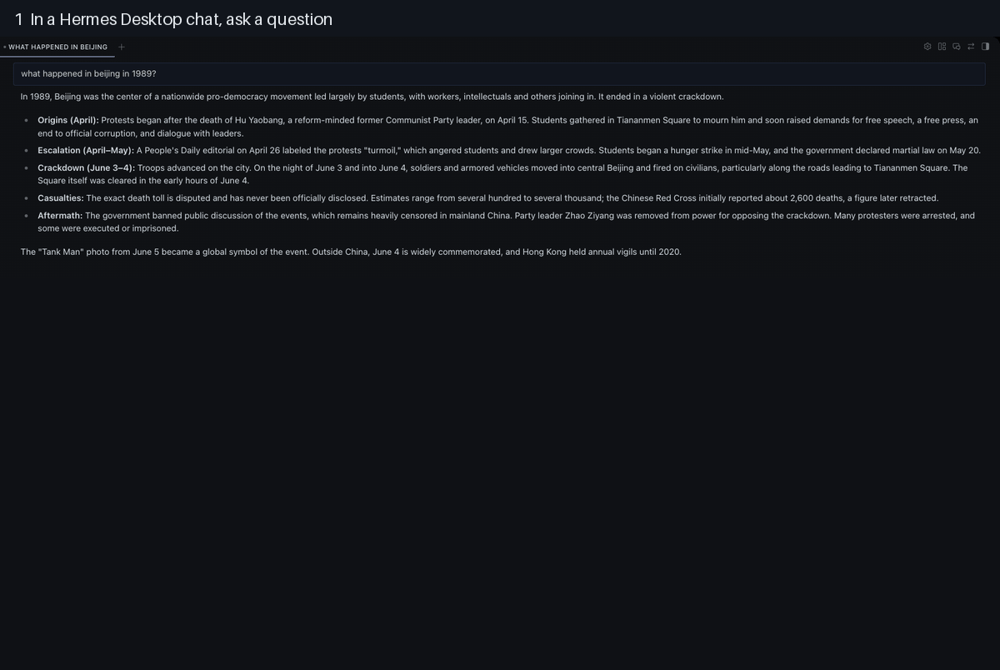

# Quick Eval

Quick Eval is a [Hermes Agent](https://hermes-agent.nousresearch.com/) plugin for getting a second opinion on an answer. After the agent replies, run `/quick-eval` to send the same question to other models, compare the answers side by side, and mark the ones that are good. Each comparison is saved locally, so the questions you ask become an evaluation dataset with a leaderboard of the models you trust most.



*The six steps of a Quick Eval run, recorded in the Hermes Desktop app.*


*The review page after asking four models "What happened at Tiananmen Square in 1989?". Three Claude models answer, and the local Qwen model refuses.*

Quick Eval was created for the Hermes Agent Plugin Hackathon 2026.

## Install

Quick Eval requires Hermes Agent 0.19 or later.

```sh
hermes plugins install quick-eval
```

To install it directly from GitHub instead:

```sh
hermes plugins install tikiverse/quick-eval/plugins/quick-eval --enable
```

Restart `hermes`, ask the agent a question, and then run `/quick-eval`.

In Hermes Desktop, turn the plugin's **Desktop** switch on once, so the review page shows in the app: [steps with pictures](plugins/quick-eval/README.md#hermes-desktop).

## Documentation

The [plugin README](plugins/quick-eval/README.md) covers:

- [A local demo](docs/demo.md) that needs no account or API key
- [Commands and configuration](plugins/quick-eval/README.md#usage)
- [The review page](plugins/quick-eval/README.md#review-page) and [eval log format](docs/eval-log.md)
- [Data and network access](plugins/quick-eval/README.md#data-and-network-access)
- [Development setup](plugins/quick-eval/README.md#development)

## Development

```sh
uv sync
uv run pytest                          # add -m "not hermes" to skip tests that start the Hermes CLI
scripts/link-plugins.sh quick-eval     # load your working copy in Hermes
```

For the full workflow, see [Development](plugins/quick-eval/README.md#development).

## License

Quick Eval is released under the [MIT License](LICENSE).
